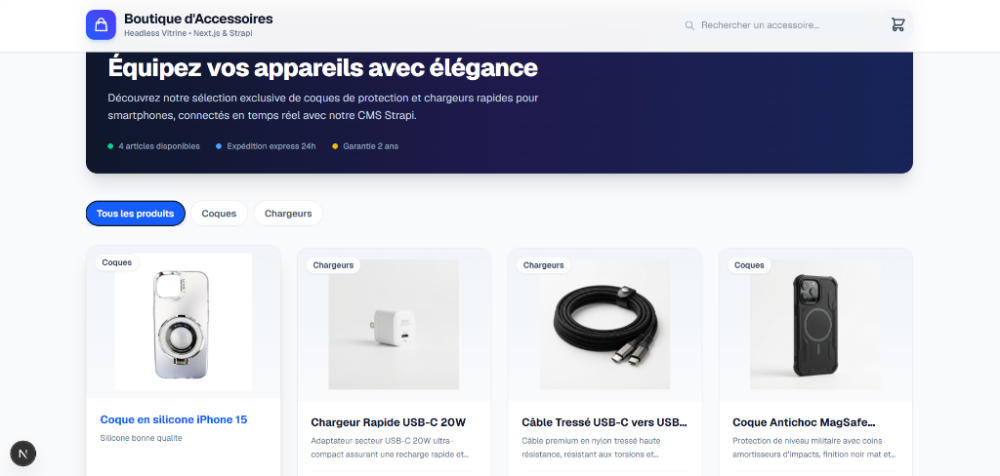
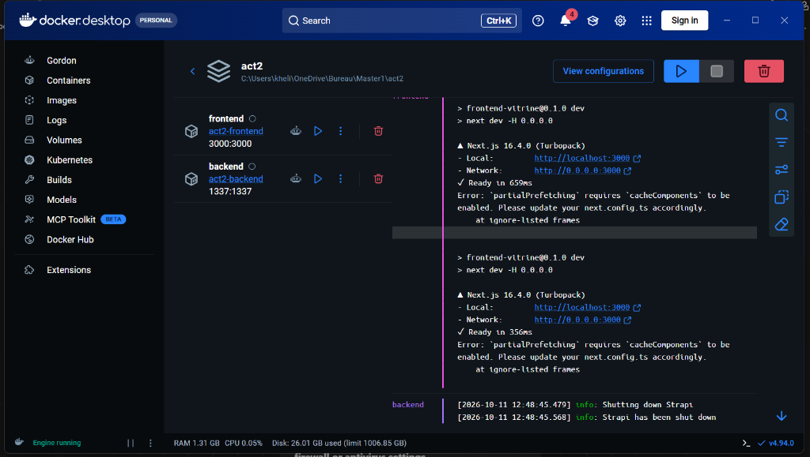

# Vitrine E-Commerce Headless (Strapi v5 + Next.js 16)

Application web e-commerce moderne conçue selon une architecture **headless**, associant le CMS **Strapi** pour la gestion de contenu et **Next.js** pour l'interface vitrine, entièrement conteneurisée avec **Docker & Docker Compose**.

---

## 📸 Aperçu du Projet

### 1. Interface de la Boutique (Nouvelle Vitrine Enrichie)
Interface utilisateur moderne, réactive et intuitive avec filtres dynamiques par catégories (*Tous les produits*, *Coques*, *Chargeurs*), recherche instantanée, compteur de panier et affichage des produits connectés à Strapi.



### 2. Déploiement et Conteneurs (Docker Desktop)
Les services **frontend** et **backend** sont orchestrés via Docker Compose sur un réseau isolé (`app-network`).



---

## 🏗️ Architecture & Technologies

- **Frontend (`frontend-vitrine`)** :
  - **Framework** : [Next.js 16](https://nextjs.org/) (App Router, Server-Side Rendering & Turbopack)
  - **Bibliothèque UI** : React 19 & Tailwind CSS
  - **Consommation API** : Fetch SSR avec fallback dynamique et gestion multi-versions Strapi
  - **Port** : `3000`

- **Backend (`backend-accessoires`)** :
  - **CMS Headless** : [Strapi v5](https://strapi.io/)
  - **Base de données** : SQLite (`.tmp/data.db`)
  - **Stockage médias** : `public/uploads`
  - **Port** : `1337` (API & Panneau d'administration)

- **Orchestration** :
  - **Docker & Docker Compose** avec volumes persistants pour les données SQLite et les fichiers médias.

---

## 🚀 Démarrage Rapide

### Prérequis
- [Docker Desktop](https://www.docker.com/products/docker-desktop/) installé et en cours d'exécution.

### Lancement avec Docker Compose

Dans le dossier racine du projet :

```bash
# Construire et démarrer les conteneurs en arrière-plan
docker compose up --build
```

### Accès aux services

| Service | URL | Description |
| :--- | :--- | :--- |
| **Vitrine Client** | [http://localhost:3000](http://localhost:3000) | Interface e-commerce publique |
| **API REST Strapi** | [http://localhost:1337/api/products](http://localhost:1337/api/products) | Endpoints REST des produits |
| **Administration Strapi** | [http://localhost:1337/admin](http://localhost:1337/admin) | Gestion des produits, catégories et médias |

---

## 📦 Gestion des Données & Ajout de Produits

### Modèle de données
- **Product** :
  - `title` (String) : Nom de l'accessoire
  - `description` (Rich Text) : Descriptif détaillé
  - `price` (Decimal) : Prix en euros
  - `image` (Media) : Visuel du produit
  - `category` (Relation) : Catégorie associée (ex: *Coques*, *Chargeurs*)

- **Category** :
  - `name` (String) : Nom de la catégorie

### Comment ajouter de nouveaux produits ?

1. Rendez-vous sur l'administration Strapi : **[http://localhost:1337/admin](http://localhost:1337/admin)**.
2. Connectez-vous avec vos identifiants administrateur.
3. Dans le menu de gauche, cliquez sur **Content Manager** > **Product**.
4. Cliquez sur **Create new entry**.
5. Renseignez les informations :
   - Titre, description, prix
   - Téléversez une image
   - Associez une catégorie (*Coques*, *Chargeurs*, etc.)
6. Cliquez sur **Save** puis sur **Publish**.
7. Rafraîchissez la page vitrine sur **[http://localhost:3000](http://localhost:3000)** pour voir le nouveau produit en ligne immédiatement.

---

## 📂 Structure du Répertoire

```text
act2/
├── docker-compose.yml              # Configuration des conteneurs backend & frontend
├── README.md                       # Documentation du projet
├── screenshots/                    # Captures d'écran et illustrations
│   ├── vitrine-finale.png          # Capture de la nouvelle interface vitrine
│   ├── docker-desktop.png          # Capture de Docker Desktop
│   └── vitrine-web.png             # Capture de la vitrine initiale
├── backend-accessoires/            # Application Strapi v5
│   ├── src/api/                    # Modèles de contenu (products, categories)
│   ├── public/uploads/             # Fichiers médias téléversés
│   ├── .tmp/data.db                # Base de données SQLite persistante
│   └── dockerfile                  # Image Docker Strapi
└── frontend-vitrine/               # Application Next.js 16
    ├── app/                        # Pages et composants React (App Router)
    │   ├── components/             # Composant interactif BoutiqueView
    │   ├── page.tsx                # Page d'accueil SSR
    │   └── layout.tsx              # Layout racine
    └── dockerfile                  # Image Docker Next.js
```
